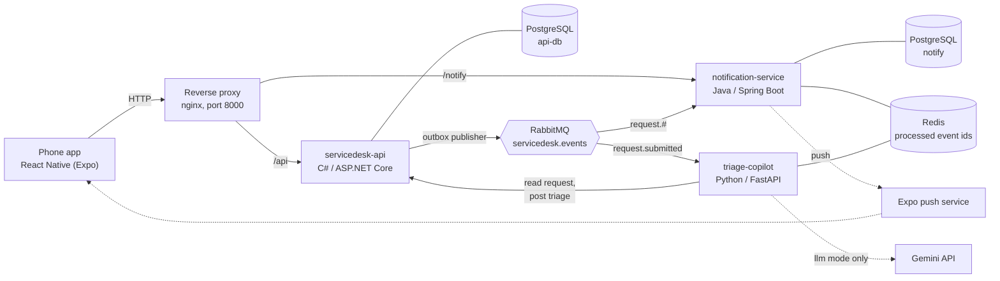

# ServiceDesk Platform (demo)

A service-request system built as four small services. Employees submit requests (equipment, software access, leave, purchase). Each request goes through an approval workflow, and approvers act on it from a phone app. An LLM copilot reads each new request and posts a triage suggestion (category, priority, route, summary, confidence). The suggestion is advisory: the copilot cannot approve, reject, cancel or fulfil anything.

This is a portfolio project built in a two-week window. It runs locally with Docker Compose. It is a demo, not a production system; see [Known limits](#known-limits).

## Architecture



| Service | Stack | What it owns |
|---|---|---|
| [`servicedesk-api/`](servicedesk-api/) | C#, ASP.NET Core 10, EF Core, PostgreSQL | Requests, workflows, approvals, the audit trail, login and JWT issuing. The only service that changes a request |
| [`notification-service/`](notification-service/) | Java 21, Spring Boot 4, PostgreSQL | Who is waiting on which step, overdue steps (`GET /notify/overdue`), device registration and push through Expo |
| [`triage-copilot/`](triage-copilot/) | Python 3.12, FastAPI, Gemini | Reads each submitted request through the API and posts one triage suggestion |
| [`mobile/`](mobile/) | React Native (Expo), TypeScript | Login, pending approvals with the copilot's summary, request detail with approve and reject |
| [`contracts/`](contracts/) | JSON Schema, OpenAPI 3.1 | The source of truth between services: event schemas and HTTP APIs |
| [`proxy/`](proxy/) | nginx | The one address the phone uses |

How the pieces fit:

- **Events through an outbox.** Every state change in the API writes the change, an audit entry and an outbox row in one database transaction. A background publisher sends the outbox rows to RabbitMQ, so an event is never lost and never sent for a change that rolled back. Event shapes are in [`contracts/events/`](contracts/events/).
- **One database per service.** No service reads another's tables; the copilot goes through the API's HTTP endpoints.
- **Idempotent consumers.** The notification service and the copilot record processed event ids in Redis and ignore repeats.
- **One token issuer.** The API issues JWTs; the other services check them with the same signing key. The copilot signs in with its own service role, which can read requests and post triage and gets 403 on everything else.
- **One address for the phone.** The proxy routes `/api` to the API and `/notify` to the notification service. Apart from its own `/proxy-health`, nothing else is reachable through it.

## Quick start

You need Docker with Compose v2, `openssl`, and Python 3.10 or later (only for the check script). The commands are for a Linux or macOS shell. The first build downloads images and compiles three services, so it takes several minutes; later starts are much faster.

**1. Get the code and create `.env`.** Every secret comes from `.env`, which is git-ignored. This fills each one with a random value and selects the copilot's canned mode, which needs no API key:

```sh
git clone https://github.com/Ahmed7796/servicedesk-platform-native.git
cd servicedesk-platform-native
cp .env.example .env
sed -i.bak \
  -e "s|^JWT_SECRET_KEY=.*|JWT_SECRET_KEY=$(openssl rand -base64 32)|" \
  -e "s|^API_DB_PASSWORD=.*|API_DB_PASSWORD=$(openssl rand -hex 16)|" \
  -e "s|^POSTGRES_PASSWORD=.*|POSTGRES_PASSWORD=$(openssl rand -hex 16)|" \
  -e "s|^RABBITMQ_DEFAULT_PASS=.*|RABBITMQ_DEFAULT_PASS=$(openssl rand -hex 16)|" \
  -e "s|^TRIAGE_CLIENT_SECRET=.*|TRIAGE_CLIENT_SECRET=$(openssl rand -hex 32)|" \
  -e "s|^COPILOT_MODE=.*|COPILOT_MODE=canned|" \
  .env && rm .env.bak
```

**2. Start the stack** and wait until every container is healthy:

```sh
docker compose up --build --wait
```

**3. Run the end-to-end check.** It goes through the proxy, as the phone does: a requester submits an equipment request, the copilot's suggestion appears, the department head and the IT manager approve, an admin fulfils, and the script checks the audit trail and the notification service. It ends with `E2E passed`.

```sh
python3 scripts/e2e.py
```

**4. Look around.**

- Swagger UI for the API: <http://localhost:8080/swagger>
- RabbitMQ management: <http://localhost:15672> (user `servicedesk`, password `RABBITMQ_DEFAULT_PASS` from `.env`)
- Sign in through the proxy and list requests:

  ```sh
  TOKEN=$(curl -s localhost:8000/api/auth/login -H 'Content-Type: application/json' \
    -d '{"identifier":"requester@servicedesk.local","password":"ServiceDesk!2026"}' \
    | python3 -c 'import json,sys; print(json.load(sys.stdin)["accessToken"])')
  curl -s localhost:8000/api/service-requests -H "Authorization: Bearer $TOKEN"
  ```

**5. Stop** and delete the data:

```sh
docker compose down -v
```

### Demo accounts

The stack runs with `ASPNETCORE_ENVIRONMENT=Development`, which seeds these accounts. Seeding never runs in any other environment. Every account's password is `ServiceDesk!2026`.

| Account | Role | Position |
|---|---|---|
| `requester@servicedesk.local` | Requester (Operations) | |
| `ops.head@servicedesk.local` | Approver (Operations) | DepartmentHead |
| `finance.head@servicedesk.local` | Approver (Finance) | DepartmentHead |
| `it.manager@servicedesk.local` | Approver | ItManager |
| `hr.manager@servicedesk.local` | Approver | HrManager |
| `finance.manager@servicedesk.local` | Approver | FinanceManager |
| `gm@servicedesk.local` | Approver | GeneralManager |
| `admin@servicedesk.local` | Admin (fulfils approved requests) | |

Workflows: Equipment goes to the requester's department head, then the IT manager. Software access goes to the IT manager, leave to the HR manager, and purchase to the department head and then the finance manager. When the requester holds a step's position, that step goes to the general manager instead.

### Using Gemini instead of canned mode

Canned mode posts a rule-based suggestion whose summary starts with `[Canned demo]`. For real suggestions, set these two lines in `.env`:

```sh
GEMINI_API_KEY=<your key>
COPILOT_MODE=llm
```

Then run `docker compose up -d --wait`, which recreates the copilot with the new values (`docker compose restart` does not re-read `.env`).

The default model is `gemini-3.5-flash-lite` (`GEMINI_MODEL` changes it). The copilot posts nothing when the model's confidence is below `COPILOT_MIN_CONFIDENCE` (default 0.5), or when it has used up `COPILOT_RATE_LIMIT_PER_MINUTE` triage runs (default 10) in the last minute. Busy Gemini models often return 503. The copilot retries, and every retry is a triage run that counts against the limit. A request whose retry hits the limit gets no suggestion. After three failed attempts, the event goes to a dead-letter queue and the request gets no suggestion.

### The phone app

The app talks only to the proxy. From `mobile/`, copy `.env.example` to `.env`, set `EXPO_PUBLIC_API_BASE_URL` to `http://<LAN address of the machine running Compose>:8000`, then run `npm ci` and `npx expo start`. Push notifications need an EAS build of the app (Expo Go cannot receive them); the steps are in [`docs/handoffs/M4-5a.md`](docs/handoffs/M4-5a.md). The screens (sign-in, pending list, detail, approve and reject) have been checked by hand on a real phone through Expo Go against this stack; push has not, because Expo Go cannot receive it.

## Tests

Each service has its own suite; the commands are in [`CLAUDE.md`](CLAUDE.md#commands). In short: `dotnet test ServiceDesk.slnx` in `servicedesk-api/`, `./mvnw test` in `notification-service/` (Docker must be running), `pytest` in `triage-copilot/` (Python 3.12, or the Docker command in its README), `npm test` in `mobile/`, and `./validate.sh` and `./lint.sh` in `contracts/`.

## Copilot evaluation

Pending. 50 labelled requests (plain, ambiguous, mislabelled and prompt-injection cases) are drafted in [`triage-copilot/evals/`](triage-copilot/evals/). The labels are checked by a person before anything is scored, because a set that an agent both wrote and graded proves nothing. After that check, `python -m evals.run` prints category and priority accuracy, and the result will be recorded here.

## Known limits

- **Not production.** No TLS, and the stack always runs in `Development` (seeded accounts with a shared password, Swagger UI on). It is meant for a local machine.
- **Push is untested on a phone.** Sending was checked in Compose against a local stand-in for Expo's push service. Registration and opening a request from a tap are covered only by the app's unit tests, not by a real device. A device is not unregistered on sign-out, so the previous user's notifications can arrive until someone else signs in on that phone.
- **The approval hierarchy is fixed in code.** Positions are a C# enum, and every escalation goes to the general manager. A data-driven model is written up in [`docs/design/approval-hierarchy.md`](docs/design/approval-hierarchy.md) but not built. The contracts already carry positions as plain strings, so that change would not break other services.
- **Failed events are parked, not replayed.** After three failed attempts an event goes to a dead-letter queue. A malformed event goes there at once. Nothing reads that queue yet. While Redis is down, the copilot retries a message every second instead of parking it.
- **The copilot's guardrails are per process.** The rate limit counts per copilot instance, and a request that was rate-limited is skipped, not queued. Canned mode uses a keyword table, so it is not resistant to prompt injection. The LLM path has prompt-injection hardening, tested with a fake model; how well it holds against a real model is what the injection cases in the eval set are for.

## How it was built

The C# API existed before this build: it is the owner's earlier project, with the domain already in place (requests, workflows, approvals, audit). In the two-week build, AI coding agents (Claude Code) moved it into this repo and extended it (PostgreSQL, the outbox and events, the service token and triage endpoint), and built the other three services, the contracts, the proxy and the Compose stack. They worked one planned task per session, under fixed architecture rules in [`CLAUDE.md`](CLAUDE.md). A separate reviewer agent checked each change, and the owner read every diff before merging it. The task list is [`docs/PLAN.md`](docs/PLAN.md), each task's hand-off is in [`docs/handoffs/`](docs/handoffs/), and [`docs/build-log.md`](docs/build-log.md) records each time an agent got something wrong and what caught it.
